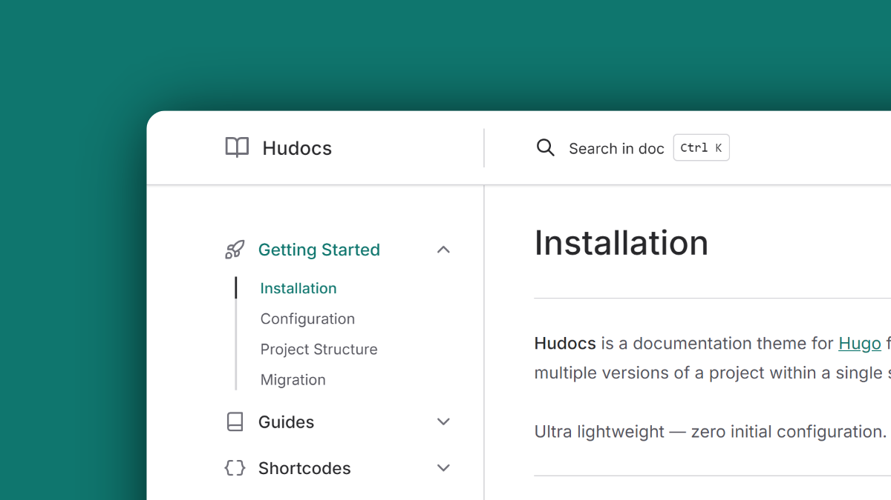

<p align="center">
  
  <h1 align="center">Hudocs</h1>
</p>

<p align="center">Documentation theme for Hugo. No Node.js dependencies and no complex deployment pipelines. Built entirely with Hugo Extended's native asset pipeline.</p>

<p align="center">
  <a href="https://github.com/zkreations/hudocs/blob/main/LICENSE"></a>
  <a href="https://github.com/zkreations/hudocs/releases"></a>
  <a href="https://app.netlify.com/projects/hudocs/deploys"></a>
</p>

<p align="center">
  <a href="https://hudocs.com/"><strong>View a live demo →</strong></a>
</p>



## Why Hudocs?

- **Single-version and multi-version support:** Works for continuously evolving products (SaaS, web apps) and for software with semantic versioning. Multi-version mode generates an isolated navigation tree, search index, and version selector for each release in the same build.
- **No Node.js required:** No `package.json`, no `node_modules`, no CI/CD orchestration beyond a standard Hugo build.
- **Fast builds:** Hugo's native pipeline handles compilation across multiple versions and languages without added overhead.
- **Client-side search:** Local search modal powered by [FlexSearch](https://github.com/nextapps-de/flexsearch), with isolated index files per language and version generated at build time.
- **Performance and security:** Optimized for [Core Web Vitals](https://pagespeed.web.dev/report?url=https://hudocs.com) with an A+ rating on [Mozilla Observatory](https://observatory.mozilla.org/analyze/hudocs.com).
- **Multilingual support (i18n):** Multi-language support linked through Hugo's i18n conventions.
- **Authoring features:** Dark/light scheme switcher, customizable code blocks with six built-in Duotone themes, tabs, steps, hints/alerts, annotated code snippets, data type badges, and [Meteor Icons](https://meteoricons.com/) integration.
- **Blog support:** Optional posts section with pagination, post cards, date formatting, and RSS feed.
- **AI assistant:** Configurable dropdown in article headers with direct actions for ChatGPT and Claude, prefilled with page context.

## Documentation

Full documentation covering installation, configuration, shortcodes, translations, and customization is available at [hudocs.com](https://hudocs.com/docs/latest/getting-started/installation/).

## Documentation Structure

Hudocs adapts automatically based on your directory layout.

### Single-version mode

For products that evolve continuously without versioned releases. Place documentation directly inside `content/docs/`:

```text
content/
└── docs/
    ├── _index.md
    ├── getting-started.md
    └── configuration.md
```

Navigation and URLs remain clean with no version dropdown.

### Multi-version mode

For software with semantic versioning where users need access to older release docs. Organize versions as subdirectories inside `content/docs/`:

```text
content/
└── docs/
    ├── latest/
    │   ├── _index.md
    │   └── ...
    ├── 1.8/
    │   ├── _index.md
    │   └── ...
    └── 1.0/
        ├── _index.md
        └── ...
```

## Shortcodes

| Shortcode | Description |
| :--- | :--- |
| `` | Renders ordered lists as numbered step-by-step guides |
| `` / `` | Tabbed content with automatic merging of consecutive syntax tabs |
| `` | Pairs code, tabs, or tables with explanatory notes |
| `` | Formats data types, expressions, and parameter structures with badge styles |
| `` | Hint or alert block (`info`, `warning`, `danger`, `success`) |
| `` | Button with primary/secondary variants and language-aware link resolution |
| `` | Styled link card with title and description |
| `` | Multi-column layout |

## Requirements

- Hugo Extended 0.164.0 or higher
- [Git](https://git-scm.com/downloads)
- [Go](https://go.dev/) (required only for Hugo Modules)

## Installation

You can install Hudocs using any of the following three methods. **Hugo Modules** is the recommended method for modern Hugo projects.

### 1. Hugo Modules (Recommended)

Hugo Modules allows you to manage Hudocs as a versioned dependency without manually tracking files or submodules. Requires [Go](https://go.dev/) installed.

1. Initialize Hugo modules in your site (if not already done):
   ```bash
   hugo mod init github.com/your-username/my-docs
   ```
2. Add Hudocs to your `hugo.toml`:
   ```toml
   theme = "github.com/zkreations/hudocs/v2"
   ```
3. Download the module:
   ```bash
   hugo mod get github.com/zkreations/hudocs/v2
   ```

### 2. Git Submodule

If you prefer not to install Go and want to pin the theme to a specific Git commit:

```bash
git submodule add https://github.com/zkreations/hudocs themes/hudocs
```

Then add the theme to your `hugo.toml`:

```toml
theme = "hudocs"
```

### 3. Direct Clone

Clone the repository directly into your `themes/` directory if you plan to modify the theme source code directly:

```bash
git clone https://github.com/zkreations/hudocs themes/hudocs
```

Then add the theme to your `hugo.toml`:

```toml
theme = "hudocs"
```

## Updating

Update Hudocs according to your installation method:

### Hugo Modules
Update to the latest version:
```bash
hugo mod get -u github.com/zkreations/hudocs/v2
```

### Git Submodule
Pull the latest changes from the remote submodule:
```bash
git submodule update --remote --merge
```

### Direct Clone
Pull latest changes from inside the theme directory:
```bash
git -C themes/hudocs pull
```

## Quick Start

If you installed via Git Submodule or Direct Clone, bootstrap your site with the `exampleSite` files:

```bash
# Copy example configuration and content
cp themes/hudocs/exampleSite/hugo.toml .
cp -R themes/hudocs/exampleSite/content .

# Start the local development server
hugo server
```

If you installed via Hugo Modules, copy or download the [`exampleSite`](https://github.com/zkreations/hudocs/tree/main/exampleSite) files from GitHub, then run:

```bash
hugo server
```

## Contributions

Contributions are welcome. Please keep these principles in mind:

- Keep configuration simple and avoid unnecessary complexity.
- Favor native HTML and CSS over JavaScript wherever possible.
- Respect user-level customization hooks and tokens.

## Support

If you find this project useful, consider [starring it on GitHub](https://github.com/zkreations/hudocs/stargazers) or [buying me a coffee](https://ko-fi.com/zkreations) to support ongoing maintenance.

## License

**Hudocs** is licensed under the [MIT License](LICENSE)
